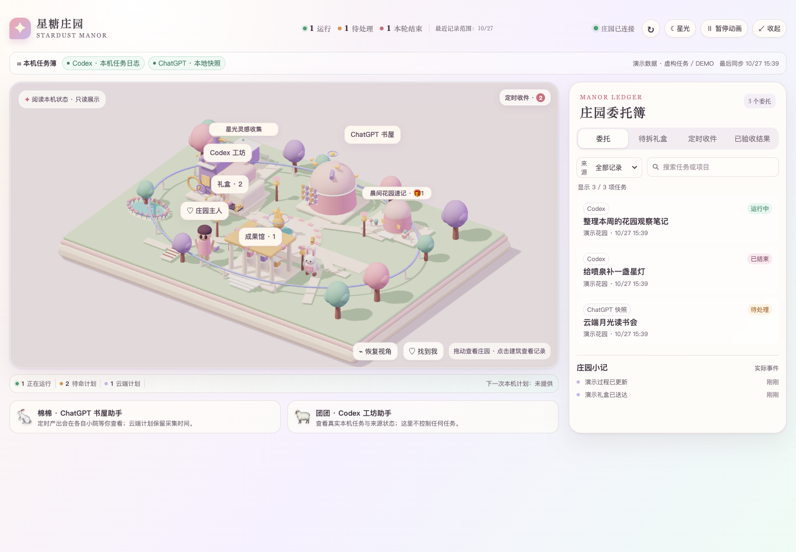
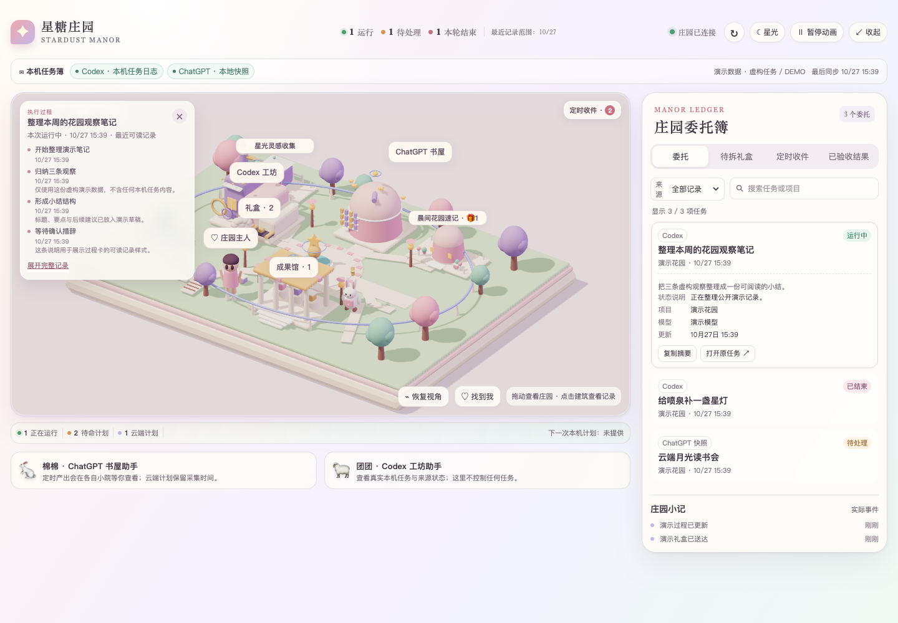
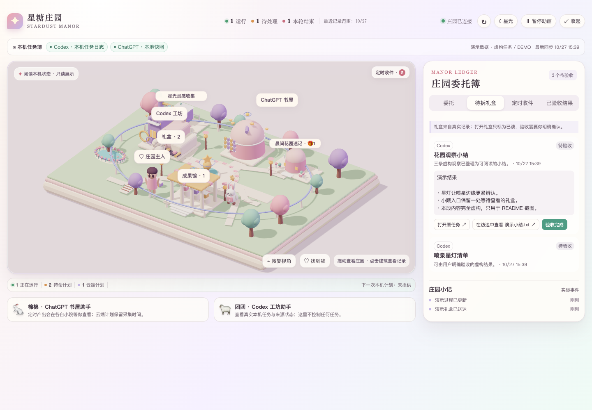
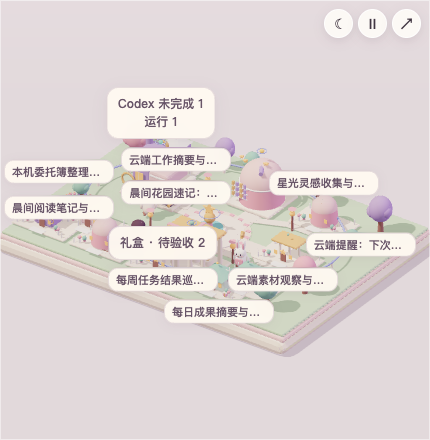

# GPT · Codex Town｜星糖庄园

> 中文：[README.zh-CN.md](README.zh-CN.md)

**A macOS 3D desktop companion for visualizing local GPT/Codex tasks, active automations, recent progress, and a review inbox.**

Codex Town turns locally available task state into a readable 3D town: workshops for current work, homes for active automations, a progress card for the latest visible local activity, and gifts waiting for your explicit review. The app UI is currently Chinese.

It is a personal, local-first companion. It does not run tasks, send messages, or upload your data. Codex Town is independent and is not affiliated with, endorsed by, or sponsored by OpenAI.



*Current app UI rendered with entirely fictional demo data, not real user records.*

## Why Codex Town?

- **See work at a glance.** Local task and automation state becomes a 3D desktop view without treating scheduled work as automatically running.
- **Keep review intentional.** Reading a result is separate from accepting it; acceptance remains an explicit local action.
- **Show useful progress carefully.** The progress card displays only the latest turn's visible local commentary and tool categories, capped at 12 events. It never displays model reasoning, prompts, command arguments, tool output, or a full execution transcript.
- **Stay honest about cloud data.** Cloud schedules and results are manually captured snapshots, not live synchronization. Cloud execution progress is unavailable.

## Features

| Area | What it does |
| --- | --- |
| 3D town | Shows the central workshop, active automation homes, result hall, transport track, and a procedural town owner in one scene. |
| Local tasks | Reads locally available Codex task and automation state without changing it. |
| Automation homes | Keeps one home per active automation ID; paused and historical plans are hidden from the current view, not deleted. |
| Progress card | Shows the latest visible local turn, its status, time, and up to 12 public progress or tool-category events. |
| Review inbox | Lets you read, explicitly accept, or reopen locally stored results. Reading does not mean acceptance. |
| Cloud snapshots | Displays timestamped, manually imported schedule and result snapshots with stale/unavailable states. |



*A local task's visible progress card: public commentary and tool categories only.*



*The review inbox keeps reading separate from explicit acceptance.*

### Mini city mode

Mini mode is a full-window 3D town for a compact view of recently readable local work, not a count of an entire account. It keeps only building bubbles and floating expand, theme, and motion controls: the workshop separates confirmed running work from work waiting for you, active automations keep their own named homes, and gifts show pending review. Unknown state is shown separately; disconnected data is marked as awaiting an update, never as zero. Cloud snapshots remain non-real-time. Clicking a building opens a small status card with an original-task link when one is available; it does not automatically open the full review view.



*City-only mini mode with fictional demo data.*

## Quick start

**Requirements:** macOS 13+, Apple Silicon, Python 3.9+, Node.js, and Xcode Command Line Tools.

```zsh
git clone https://github.com/ppdbxdawj/gpt-codex-town.git
cd gpt-codex-town
npm ci --ignore-scripts
npm run prepare:vendor
zsh desktop/build-app.sh
open 星糖庄园.app
```

The project-level `.npmrc` uses the public npm registry. `prepare:vendor` rebuilds the local Three.js runtime and its bundled third-party notice; the build script creates and ad-hoc signs the native app.

## Data boundaries

- Local Codex data is read-only.
- Cloud schedules and results are optional, manually imported snapshots. They are not real-time or complete cloud synchronization.
- An automation's local progress is associated by task reference; it does not prove that the automation triggered that run.
- Results, read state, and acceptance records remain local. The app never automatically accepts a result.
- The bundled town owner is procedural. Personal models, textures, task logs, databases, private screenshots, and private snapshots are not included in this repository.

## Verification

The source includes Python and Node test suites:

```zsh
python3 -B -m unittest discover -s tests -v
node --test tests/test_*.mjs
```

## Roadmap

- Improve visual polish and accessibility for the town and review flows.
- Improve live progress updates and add English UI support.
- Validate night mode, motion preferences, notifications, and performance on more macOS configurations.
- Document reproducible release checks and public distribution workflow.

## Contributing

Contributions are welcome. Read [CONTRIBUTING.md](CONTRIBUTING.md) before opening a change, especially the rules for keeping personal task data and assets out of the repository.

If Codex Town helps you make sense of local AI-assisted work, please consider giving it a star. Fork it to explore your own local-first task visualization ideas.

## Third-party notices and license

Third-party notices are in [THIRD_PARTY_NOTICES.md](THIRD_PARTY_NOTICES.md). A license for this repository's source code has not yet been specified; no open-source license is granted by this repository at this time.
